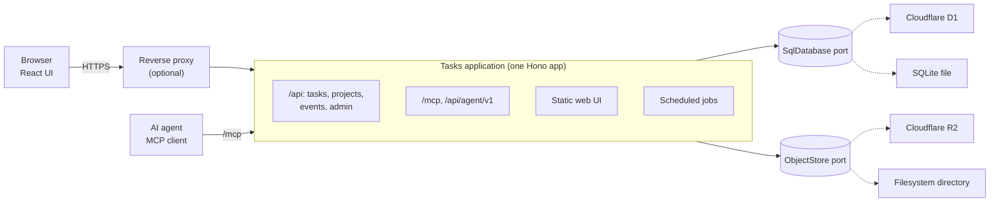

# Tasks

**A small-team task tracker that humans and AI agents work in together, and that you can run from a
single container.**

Tasks is a Hono API with a React UI. It tracks projects, tasks, comments and history, has an optional
module for planning events (requests, deadlines, owners, approvals, artwork versions), and exposes
the same data to AI agents through an MCP endpoint. The same code runs on Cloudflare Workers with D1
and R2, or as one Node process with a SQLite file and a directory of uploads. MIT licensed.

It is for a team of up to a few dozen people who want a tracker they host and can read end to end:
one process, one database file, no queue, no cache, no external service you did not choose.

## What you get

- **Tasks and projects.** Status (`backlog`, `not_started`, `in_progress`, `blocked`, `done`),
  priority, effort, due date, task types and one assignee per task. Views for open, mine, backlog
  and completed work; search, sort and a command palette. Projects are visible to the whole
  workspace or private to their members, and everyone also gets a personal project.
- **Comments, history, audit.** Comments with `@mentions`, a per-task history of every change, and an
  audit log. Edits use optimistic concurrency: an update made against a
  stale version fails with 409 instead of overwriting someone else's change.
- **AI agents as first-class users.** A built-in `Agent` principal can be assigned work and leave
  comments. Agents reach Tasks through the [MCP endpoint](#use-it-from-an-ai-agent-mcp) or a small
  HTTP API, with read-only or read/write credentials, optional expiry, and idempotency keys on every
  write.
- **Events module (optional).** An event request becomes a plan: deadlines worked back from the
  event date, accountable owners per area (communications, facilities, registration, ...), versioned
  copy and artwork, human approvals, and a readiness gate before an event is marked ready. An
  analytics page reports how long each step takes. Turn the module off with `FEATURE_MODULES`.
- **People and roles.** Built-in Administrator, Manager, Member and Viewer roles plus custom roles
  built from plain-language permissions. A searchable directory with bulk invite, role assignment
  and disable, an audit log view, and viewing the application as another user. Nobody can grant more
  than they hold, and the last administrator can't be removed.
- **Your identity provider.** Sign in with Google, or put the app behind a reverse proxy that
  authenticates users (oauth2-proxy, Authentik, ...) and hands it the email in a header.

## Try it in five minutes

You need Node 24 or newer and nothing else. This runs the real server against a local SQLite file,
signed in as an administrator without any identity provider, **bound to your loopback interface**.

```sh
git clone <this repository> tasks && cd tasks
npm ci
npm run build
node examples/local/try-it.mjs you@example.org
```

Open <http://127.0.0.1:8080>. Your data lives in `./.tasks-local`; delete the directory to start
over. The script starts the server on port 8081 in trusted-upstream mode and a ten-line proxy on
8080 that stamps every request with your email, which is exactly what a real authenticating proxy
does, minus the authentication. Never expose it beyond your machine.

## Run it for real

### With Docker (Google sign-in)

```sh
docker build -t tasks .
cp examples/google-sign-in/tasks.env.example tasks.env     # then edit tasks.env
docker run -d --name tasks -p 8080:8080 \
  --read-only --tmpfs /tmp -v tasks-data:/data \
  --env-file tasks.env tasks
```

In `tasks.env`, set your Google OAuth client (type "Web application", with
`<TASKS_PUBLIC_ORIGIN>/auth/callback` as an authorized redirect URI), `SESSION_SECRET` (the example
leaves it empty on purpose; use `openssl rand -hex 32`), `TASKS_PUBLIC_ORIGIN`, and
`TASKS_INITIAL_ADMIN_EMAIL`. Migrations apply to an empty database at startup. `GET /readyz` reports
`{"ok":true,...}` once the database is migrated and sign-in is configured; `GET /healthz` reports the
process. With `ENVIRONMENT=production` the container refuses to start, naming only the missing
variables, unless sign-in is fully configured.

To run migrations separately, for example before an upgrade, use the same environment:

```sh
docker run --rm -v tasks-data:/data --env-file tasks.env tasks node dist/migrate.js
docker run --rm -v tasks-data:/data --env-file tasks.env tasks node dist/migrate.js --status
```

Compose files for both sign-in modes are in [`examples/`](examples/). The trusted-upstream example
runs oauth2-proxy in front of the app, and only the proxy publishes a port.

### Hosting options

| Shape | State | Notes |
| --- | --- | --- |
| Self-hosted container | SQLite file + filesystem directory | The recommended way to start. One process per database file; back up both together. |
| Cloudflare Worker | D1 + R2, Cron Triggers | The same code: `npm run build:worker` bundles it and `wrangler.jsonc` is the neutral template to deploy with. |
| Postgres, S3-compatible storage, multiple replicas | | **Not built.** The SQL and object-store ports exist; the adapters and a dialect port do not. |

Details, every variable, backups and limits: [`docs/HOSTING.md`](docs/HOSTING.md).

## How it fits together



The application depends only on two narrow ports (`src/platform/ports.ts`): a SQL database and an
object store. D1 and R2 satisfy them directly; the self-hosted build supplies a `node:sqlite` driver
and a filesystem store. One suite of contract tests runs against both implementations.
`src/` is the API and runtime, `web/` the React UI, `shared/` code used by both, `migrations/` the
schema.

## Use it from an AI agent (MCP)

Tasks serves a stateless Streamable HTTP MCP endpoint at `/mcp`. Its tools call the same handlers
the browser uses, so validation, permissions, audit history and concurrency checks are shared. The
tools are `task_list`, `task_search`, `task_get`, `task_create`, `task_update` (needs the current
task version) and `task_comment`. Writes need an idempotency key.

MCP is optional and off on a new install. To turn it on with a token:

1. Create a credential. It prints the token once, plus a registry entry:

   ```sh
   node dist/mcp-create-credential.js --name "My agent" --scope read_write
   # from a checkout: npm run mcp:create-credential -- --name "My agent" --scope read_write
   ```

2. Configure the server, keeping the registry as a secret:

   ```sh
   TASKS_MCP_ENABLED=true
   TASKS_MCP_AUTH_MODE=token
   TASKS_MCP_CREDENTIALS_JSON='{"version":1,"credentials":[<entry>]}'
   ```

3. Point your client at `<TASKS_PUBLIC_ORIGIN>/mcp` with `Authorization: Bearer <token>`.

Use HTTPS, because the token is the only credential in this mode. A reverse proxy must preserve the
`Host` header, since `/mcp` accepts only the host of `TASKS_PUBLIC_ORIGIN`. `read` credentials can't
write. Set `TASKS_MCP_ENABLED=false` to switch MCP off on any server, even with credentials
configured; `/mcp` and `/api/agent/v1` then answer 404.

The default mode, `gateway-and-token`, also requires a secret that a private gateway adds to each
request, so a leaked client token is useless on its own. See
[`docs/HOSTING.md`](docs/HOSTING.md#mcp-server) for that mode, rotation and client configuration.
The agent is a database user that cannot sign in; its permissions are task view, manage and comment.

## Configuration

The settings you will touch first. Everything else, with defaults, is in
[`docs/HOSTING.md`](docs/HOSTING.md).

| Variable | Meaning |
| --- | --- |
| `ENVIRONMENT`, `RELEASE_SHA` | Required. `local`, `dev` or `production`; any non-empty build identifier. |
| `TASKS_DATASTORE=sqlite`, `TASKS_SQLITE_PATH` | Use SQLite at that path. Without them only the adapter-only portable runtime starts. |
| `TASKS_OBJECT_STORE=filesystem`, `TASKS_OBJECT_STORE_PATH` | Store event assets under that directory. Without them asset routes answer 503. |
| `TASKS_AUTH_MODE` | `session` (default, Google) or `trusted-upstream` (identity from a proxy header). |
| `GOOGLE_CLIENT_ID`, `GOOGLE_CLIENT_SECRET`, `SESSION_SECRET` | Required in `session` mode. Use a `SESSION_SECRET` of 32+ random characters. |
| `TASKS_TRUSTED_UPSTREAM_EMAIL_HEADER`, `TASKS_TRUSTED_UPSTREAM_TRUST=proxy-replaces-headers` | Required in `trusted-upstream` mode; the second is your acknowledgement that only the proxy can reach the app. |
| `TASKS_PUBLIC_ORIGIN` | Browser-facing origin. Set it behind a TLS-terminating proxy so redirect URIs and the CSRF origin check match. |
| `TASKS_HOSTED_DOMAIN` | Only addresses in this domain can sign in; anyone in it is created at first sign-in. No default. |
| `TASKS_INITIAL_ADMIN_EMAIL` | Created at first sign-in with every permission. No default. |
| `FEATURE_MODULES` | Subset of `tasks,projects,events,workflows`; default all. Can only turn modules off. |
| `TASKS_SITE_HOST`, `TASKS_SITE_PORT` | Listen address; default `0.0.0.0:8080`. |
| `TASKS_SCHEDULER` | `enabled` (default) or `disabled`; runs deadline notifications and log retention in-process. |

**Access fails closed.** With no `TASKS_HOSTED_DOMAIN`, only the initial administrator and users an
administrator created can sign in. Anyone else is denied and nothing is written for them.

## Security model

- **Identity.** Google OAuth with PKCE and a signed 12-hour session cookie, or a proxy-supplied email
  header. Permissions are read from the database on every request; claims in the cookie are never
  trusted for authorization. A disabled user loses access on their next request.
- **Browser writes** need a same-origin `Origin` header and a double-submit CSRF token. The
  session cookie is `HttpOnly`, `Secure` and `SameSite=Lax`; the CSRF cookie is `Secure` and
  `SameSite=Strict`. No cross-origin (CORS) access is granted.
- **Agents** authenticate with a bearer token, plus a gateway secret unless token mode is chosen,
  and cannot mutate with a read-only credential, over MCP or HTTP.
- **Input.** All SQL is parameterized; request bodies are size-limited before they are parsed;
  uploads are limited to PNG, JPEG, WebP and PDF up to 50 MB and always downloaded as attachments;
  stored links must be http(s).
- **Responses** carry `nosniff`, `X-Frame-Options: DENY` and a strict referrer policy. A full
  Content-Security-Policy and HSTS belong in your reverse proxy.
- **What it does not do.** There is no built-in rate limiting (apply it at your proxy), no password
  login, no server-side session revocation beyond disabling the user, and no multi-replica
  deployment. In trusted-upstream mode the app trusts the header completely, so it must be reachable
  only through the proxy.

Report vulnerabilities privately: see [SECURITY.md](SECURITY.md).

## Develop

Node 24 or newer.

```sh
npm ci
npm run check               # format, lint, typecheck
npm test                    # unit, integration and contract tests (includes real workerd D1/R2)
npm run build               # Worker bundle, self-hosted server, MCP runtime, web UI
npm run smoke:self-hosted   # boots the built server from empty and checks both sign-in modes
npm run dev                 # Vite dev server for the UI
```

Tests run twice, once with the neutral default profile and once with every optional capability
enabled. The task HTTP API is described in [`docs/TASK_API.md`](docs/TASK_API.md).

## Tenant profile

The build compiles one tenant profile, `shared/tenant-profile.ts`. The default is neutral: no hosted
domain, no administrator, no origins and no external integrations. A deployment can keep its own
copy of `shared/tenant-profile.ts`, `src/runtime/tenant-adapters.ts` and `wrangler.jsonc` and build
this source with them. The profile controls:

| Field | Purpose |
| --- | --- |
| `identity.hostedDomain`, `identity.initialAdminEmail` | Compile a sign-in domain and first administrator into the build. A compiled domain cannot be loosened at runtime. |
| `origins`, `links.portal` | Browser origins (CSRF, links in email) and the portal link. |
| `capabilities.*` | Optional modules (portal, mobile API, support intake, alerts, email, events, analytics). `FEATURE_MODULES` can only disable what is compiled in. |
| `integrations.*` | Endpoints, header prefixes and hosts for email, mobile, portal and event-assist integrations. Enabling a capability without its settings makes the readiness check fail. |
| `events` | Event vocabulary: presets, destinations, rooms, equipment, default time zone, and labels. |

## Project

This repository is published from a maintained source tree as a reviewed snapshot per release
(`PUBLIC-SOURCE.json` records the version, `PUBLIC-FILES.sha256` the file digests). Pull requests are
welcome and are imported, reviewed and released by the maintainers; see
[CONTRIBUTING.md](CONTRIBUTING.md). Licensed under the MIT terms in [LICENSE](LICENSE).
